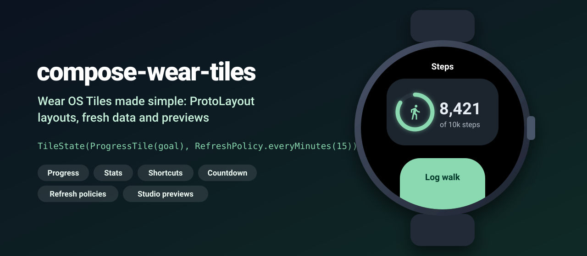
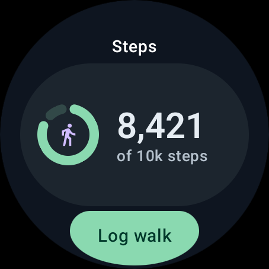
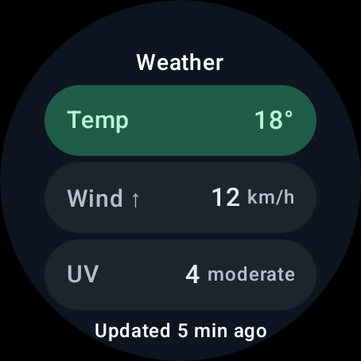
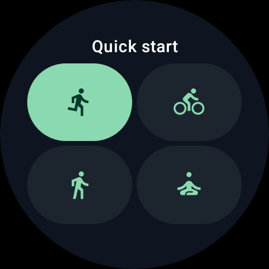
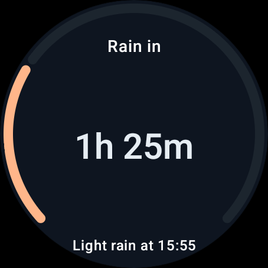

<p align="center">
  
</p>

<p align="center">
  <a href="https://github.com/halilozel1903/compose-wear-tiles/actions/workflows/ci.yml"></a>
  <a href="https://jitpack.io/#halilozel1903/compose-wear-tiles"></a>
  
  
  
  
  
  <a href="LICENSE"></a>
</p>

**compose-wear-tiles** makes Wear OS Tiles simple. Write one suspend function that returns what the tile shows, pick a ready-made layout (`ProgressTile`, `StatsTile`, `ShortcutsTile`, `CountdownTile`) built with ProtoLayout and its Material 3 components, and the library does the rest: images become versioned tile resources automatically, a `RefreshPolicy` becomes the tile's freshness interval, taps launch your activities or refresh the tile, `requestTileUpdate<T>()` pushes fresh data, and the same layouts render in Android Studio previews. The logic behind it (tile data models, refresh rules, compact formatting, layout decisions per screen size and resource versioning) lives in a plain Kotlin module with unit tests.

```kotlin
class StepsTileService : SimpleTileService() {
    override suspend fun tileState(request: TileStateRequest): TileState {
        val steps = repository.todaySteps()
        return TileState(
            layout = ProgressTile(ProgressGoal("Steps", steps, target = 10_000.0, unit = "steps")),
            refresh = RefreshPolicy.everyMinutes(15),
        )
    }
}
```

## Screenshots

The four tile layouts of the library, filled with the data of the sample app Trailmate (a small fitness and weather companion) and captured by CI on a Wear OS emulator (large round, 454 x 454).

These are not screenshots of the system tile carousel: CI cannot add tiles to the carousel and capture it reliably. Each screenshot shows a tile layout rendered by the official Wear OS tiles renderer (`androidx.wear.tiles:tiles-renderer`) inside the sample's tile gallery activity, which inflates exactly the layout its tile service sends to the watch.

| ProgressTile | StatsTile | ShortcutsTile | CountdownTile |
| :---: | :---: | :---: | :---: |
|  |  |  |  |

## Why

A tile is not a screen: it is a ProtoLayout tree sent to the system, with its images in a separate, versioned resource bundle, a freshness interval instead of state, and `ListenableFuture` callbacks. Every app ends up writing the same plumbing: a coroutine bridge for `onTileRequest`, a resource version that changes exactly when the images change, an `onTileResourcesRequest` that survives process death, `Clickable`s with `LaunchAction`s and string extras, refresh intervals that line up with the data, and layouts that behave on a 192 dp and a 227 dp screen. compose-wear-tiles packs that into a base service, four layouts and a pure Kotlin core.

## Features

- **`SimpleTileService`**: implement `suspend fun tileState(request): TileState`. Coroutines run on the main thread and are cancelled with the service; layouts are built with protolayout-material3 in your `TileTheme`; images are collected into resources with a stable version (rebuilt on demand if the process died between the tile and the resources request); a failing `tileState` shows a retry tile instead of a broken one.
- **`ProgressTile`**: progress towards a goal in a graphic data card: a ring with an optional icon, `8,421`, `of 10k steps`, and an edge button or the percentage at the bottom.
- **`StatsTile`**: two (small screens) or three (large screens) full-width rows with the label and trend arrow on the left and the value on the right, units on large screens, and "Updated 5 min ago" at the bottom.
- **`ShortcutsTile`**: icon buttons in balanced rows (4 shortcuts are 2 + 2, 5 on a large screen are 3 + 2), up to 4 on small and 6 on large screens, the first one highlighted.
- **`CountdownTile`**: the remaining time in the middle and a ring along the edge of the screen that fills as the moment comes closer. The time counts down live on the watch with ProtoLayout dynamic time expressions (`1h 25m`, `25m`, `<1m`, then your done label), falling back to static text on old renderers.
- **`MessageTile`**: empty, signed out and error states with an optional action.
- **`TileAction`**: `TileAction.launch<WorkoutActivity>("type" to "run")` opens an activity with string extras; `TileAction.Refresh` asks for a new tile and tells you what was tapped in `request.lastClickId`.
- **Fresh data**: `RefreshPolicy.everyMinutes(15)`, `hourly()` (top of the hour), `At(time)`, `earliestOf(...)`, and `Countdown.refreshPolicy()` become the tile's freshness interval; `context.requestTileUpdate<StepsTileService>()` updates now.
- **Previews**: `layout.previewData(context)` returns the `TilePreviewData` for Android Studio's `@Preview` tile previews.
- **Pure Kotlin core**: `ProgressGoal`, `StatList`, `ShortcutGrid`, `Countdown`, `RefreshPolicy` and `Freshness`, `TileFormat` (`12.4k`, `8,421`, `1h 05m`, `5 min ago`), `TileScreen` and `TileLayoutSpec` (small and large round decisions) and `ResourceVersion` run on any JVM.

## Installation

Add JitPack to `settings.gradle.kts`:

```kotlin
dependencyResolutionManagement {
    repositories {
        google()
        mavenCentral()
        maven("https://jitpack.io")
    }
}
```

Then the dependency:

```kotlin
dependencies {
    implementation("com.github.halilozel1903.compose-wear-tiles:compose-wear-tiles:1.0.0")
    // Android Studio tile previews:
    debugImplementation("androidx.wear.tiles:tiles-tooling:1.5.0")
    // Pure Kotlin models, refresh rules and formatting only (for JVM modules):
    // implementation("com.github.halilozel1903.compose-wear-tiles:compose-wear-tiles-core:1.0.0")
}
```

The library brings `androidx.wear.tiles:tiles` 1.5.0, `androidx.wear.protolayout:protolayout`, `protolayout-expression` and `protolayout-material3` 1.3.0, `tiles-tooling-preview` 1.5.0 and `kotlinx-coroutines-android` as `api` dependencies and needs `minSdk` 30 (Wear OS 3).

> The build is also set up for Maven Central (`io.github.halilozel1903:compose-wear-tiles`) via the vanniktech publish plugin.

## Usage

**1. A tile service**

```kotlin
class WeatherTileService : SimpleTileService() {

    override val theme = TileTheme(colorScheme = myColorScheme, allowDynamicColors = true)

    override suspend fun tileState(request: TileStateRequest): TileState {
        val weather = withContext(Dispatchers.IO) { api.currentWeather() }
        return TileState(
            layout = StatsTile(
                StatList(
                    title = "Weather",
                    items = listOf(
                        StatItem("Temp", "${weather.temperature}°"),
                        StatItem("Wind", "${weather.wind}", unit = "km/h", trend = Trend.Up),
                        StatItem("UV", "${weather.uv}", unit = "moderate"),
                    ),
                    updatedAtMillis = weather.updatedAt,
                ),
            ),
            // At the top of every hour, and at least every 30 minutes.
            refresh = RefreshPolicy.earliestOf(RefreshPolicy.hourly(), RefreshPolicy.everyMinutes(30)),
        )
    }
}
```

Register it like any tile service:

```xml
<service
    android:name=".WeatherTileService"
    android:exported="true"
    android:label="@string/tile_weather"
    android:permission="com.google.android.wearable.permission.BIND_TILE_PROVIDER">
    <intent-filter>
        <action android:name="androidx.wear.tiles.action.BIND_TILE_PROVIDER" />
    </intent-filter>
    <meta-data android:name="androidx.wear.tiles.PREVIEW" android:resource="@drawable/tile_preview_weather" />
</service>
```

**2. Layouts and actions**

```kotlin
ProgressTile(
    goal = ProgressGoal("Steps", current = 8_421.0, target = 10_000.0, unit = "steps"),
    icon = R.drawable.ic_steps,                                    // added to the tile resources for you
    button = TileButton("Log walk", TileAction.launch<WorkoutActivity>("type" to "walk")),
)

ShortcutsTile(
    title = "Quick start",
    shortcuts = listOf(
        TileShortcut("Run", R.drawable.ic_run, TileAction.launch<WorkoutActivity>("type" to "run")),
        TileShortcut("Ride", R.drawable.ic_bike, TileAction.launch<WorkoutActivity>("type" to "ride")),
        TileShortcut("Walk", R.drawable.ic_walk, TileAction.launch<WorkoutActivity>("type" to "walk")),
        TileShortcut("Yoga", R.drawable.ic_yoga, TileAction.launch<WorkoutActivity>("type" to "yoga")),
    ),
)

val rain = Countdown("Rain in", targetMillis = rainAt, startMillis = forecastAt, subtitle = "Light rain at 16:00")
TileState(
    layout = CountdownTile(rain),                                   // ticks on the watch by itself
    refresh = rain.refreshPolicy(request.nowMillis, live = true),   // new data once the rain starts
)
```

Activities opened from a tile must be exported. `TileAction.Refresh` reloads the tile; the id of the tapped element (`stat_0`, `progress_card`, or your `TileShortcut.id`) arrives as `request.lastClickId`.

**3. Fresh data now**

```kotlin
repository.logWalk(steps = 500)
context.requestTileUpdate<StepsTileService>()
// or TileUpdates.requestAll(context, StepsTileService::class.java, WeatherTileService::class.java)
```

**4. Your own layout**

`TileLayout` is a fun interface; build with the protolayout-material3 functions on `scope.material`, register images with `scope.image(R.drawable.x)` and make clickables with `scope.clickable(action, id)`. `scope.spec` tells you what fits on the screen.

```kotlin
val waterTile = TileLayout { scope ->
    with(scope.material) {
        primaryLayout(
            titleSlot = { text("Water".layoutString) },
            mainSlot = {
                iconButton(
                    onClick = scope.clickable(TileAction.Refresh, "add_glass"),
                    iconContent = { icon(scope.image(R.drawable.ic_glass)) },
                    width = expand(),
                    height = expand(),
                )
            },
        )
    }
}
```

**5. Previews in Android Studio**

```kotlin
@Preview(device = WearDevices.LARGE_ROUND)
@Preview(device = WearDevices.SMALL_ROUND)
fun stepsTilePreview(context: Context) =
    ProgressTile(ProgressGoal("Steps", 8_421.0, 10_000.0, "steps")).previewData(context)
```

**6. Rendering a layout yourself**

```kotlin
val rendered = TileRendering.render(context, TileRendering.deviceParameters(context), layout, theme)
TileRenderer(context, mainExecutor) { }.inflateAsync(rendered.layout, rendered.resources, frameLayout)
```

This is how the sample's tile gallery draws the README screenshots.

**Core without Android**

```kotlin
TileFormat.compact(12_400)              // "12.4k"
TileFormat.grouped(8_421)               // "8,421"
TileFormat.countdown(85 * 60_000L)      // "1h 25m"
TileFormat.age(updatedAt, now)          // "5 min ago"

Freshness.intervalMillis(RefreshPolicy.hourly(), now)          // millis until the top of the hour
Freshness.isStale(updatedAt, now, maxAgeMillis = 2 * 3_600_000)

TileScreen(227, 227).screenClass                                // ScreenClass.LargeRound
TileScreen.SmallRound.layout.maxStats                           // 2
TileLayoutSpec.balancedRows(count = 5, maxColumns = 3)          // [3, 2]
ResourceVersion.of(mapOf("image_ic_run" to R.drawable.ic_run))  // "r3f2c..." (stable)
```

## API

| Component | What it does |
| --- | --- |
| `SimpleTileService` | `TileService` with `suspend tileState()`, automatic resources, freshness and an error state |
| `TileState` / `TileStateRequest` | What the tile shows and when it refreshes / tile id, screen, last clicked id, time |
| `ProgressTile(goal, icon, button, onClick)` | Goal progress in a graphic data card with a ring |
| `StatsTile(stats, button, onClick)` | 2 or 3 rows with labels, trends, values and units |
| `ShortcutsTile(title, shortcuts, button)` / `TileShortcut` | Icon buttons in balanced rows |
| `CountdownTile(countdown, live, button, onClick)` | Live countdown with a progress ring along the screen edge |
| `MessageTile(title, message, button)` | Messages and errors |
| `TileAction` / `TileButton` | Launch an activity with extras or refresh; the edge button |
| `TileLayout` / `TileScope` / `TileTheme` | Write your own layouts with protolayout-material3 |
| `TileRendering` / `RenderedTile` | Build a layout outside a service: layout, resources, version, `toTile()` |
| `requestTileUpdate<T>()` / `TileUpdates` | Ask Wear OS for fresh tiles |
| `TileLayout.previewData(context)` | `TilePreviewData` for `@Preview` tile previews |

Core (`io.github.halilozel1903.weartiles.core`):

| Type | What it does |
| --- | --- |
| `ProgressGoal` | Fraction, percentage, remaining, `8,421` / `8.4k`, `of 10k steps` |
| `StatItem` / `StatList` / `Trend` | Stats with units and trends, visible items per screen, "Updated 5 min ago" |
| `ShortcutGrid` | Items cut to the screen and split into balanced rows |
| `Countdown` | Remaining time and text, progress, when the text changes next, refresh policy |
| `RefreshPolicy` / `Freshness` | Never, every, aligned, at, earliest; tile freshness interval and staleness |
| `TileFormat` | `compact`, `grouped`, `number`, `percent`, `duration`, `countdown`, `age`, `timeOfDay` |
| `TileScreen` / `ScreenClass` / `TileLayoutSpec` | Small and large round (and rect) screens and what fits on them |
| `ResourceVersion` | Stable resource versions from the images a tile uses |

## Sample

The `sample` module is **Trailmate**, a fictional fitness and weather companion with four tiles: Steps (`ProgressTile`, refreshes every 15 minutes and right after "Log walk"), Weather (`StatsTile`, refreshes on the hour), Quick start (`ShortcutsTile`, opens a workout) and Rain (`CountdownTile`, ticks live). Its launcher activity is the tile gallery; for the screenshots it shows one tile on fixed data and a fixed clock:

```bash
adb shell am start -n io.github.halilozel1903.weartiles.sample/.MainActivity --es scene progress   # progress, stats, shortcuts, countdown
```

To see the real tiles, install the sample on a watch or emulator, long press the watch face or swipe to the tiles and add them.

## Project structure

| Module | What it is |
| --- | --- |
| `tiles-core` | Pure Kotlin: tile data models, refresh policies and freshness, formatting, layout decisions by screen size, resource versions. Published as `compose-wear-tiles-core` |
| `tiles` | Android: `SimpleTileService`, the ProtoLayout Material 3 layouts, actions, rendering, update requests and previews. Published as `compose-wear-tiles` |
| `sample` | Trailmate with its four tile services, the tile gallery and Android Studio previews |

## Tech stack

Kotlin 2.4 · AGP 9.4 with built-in Kotlin · Gradle 9.6 · Wear OS Tiles 1.5 (`tiles`, `tiles-renderer`, `tiles-tooling`) · ProtoLayout 1.3 with Material 3 · Kotlin coroutines · GitHub Actions with a Wear OS emulator

## License

MIT. See [LICENSE](LICENSE).
